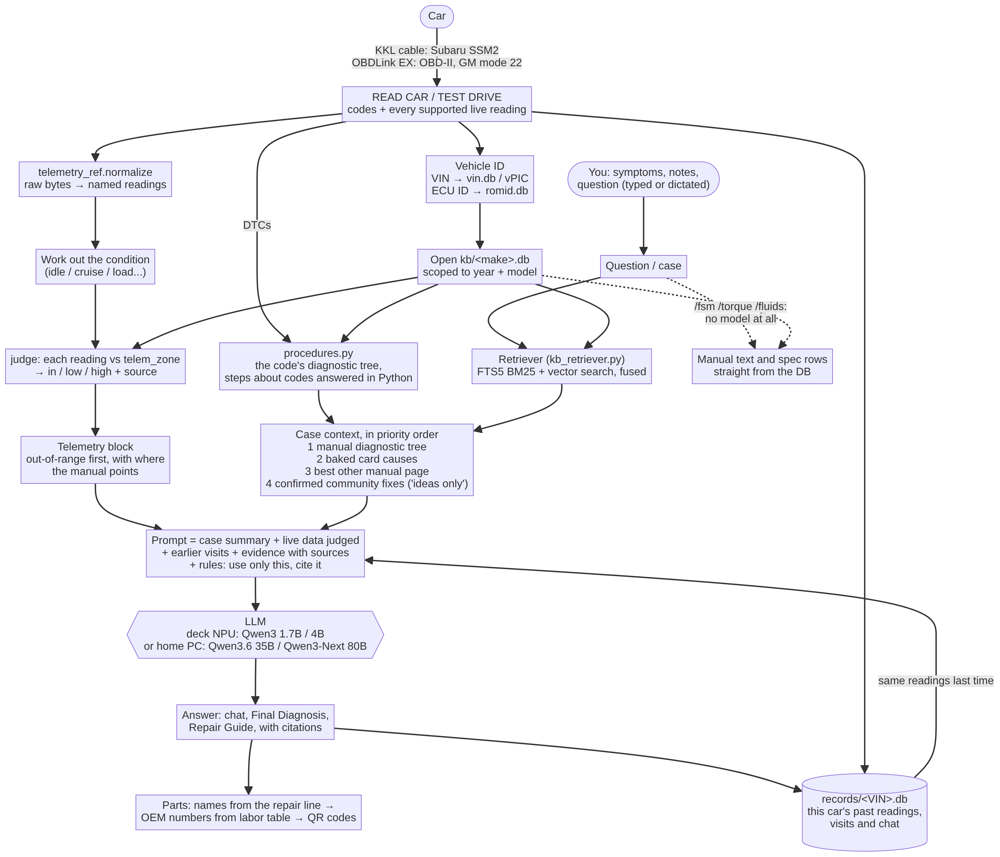
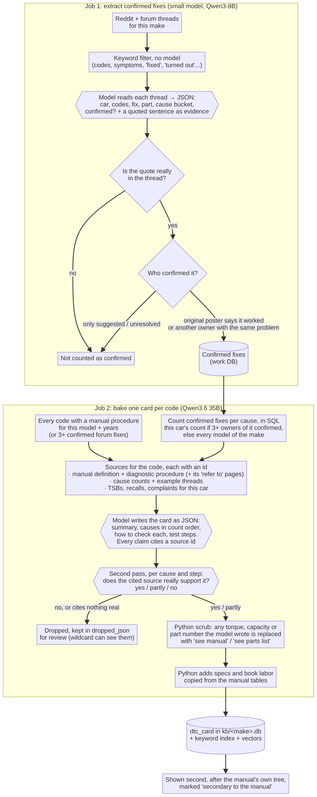
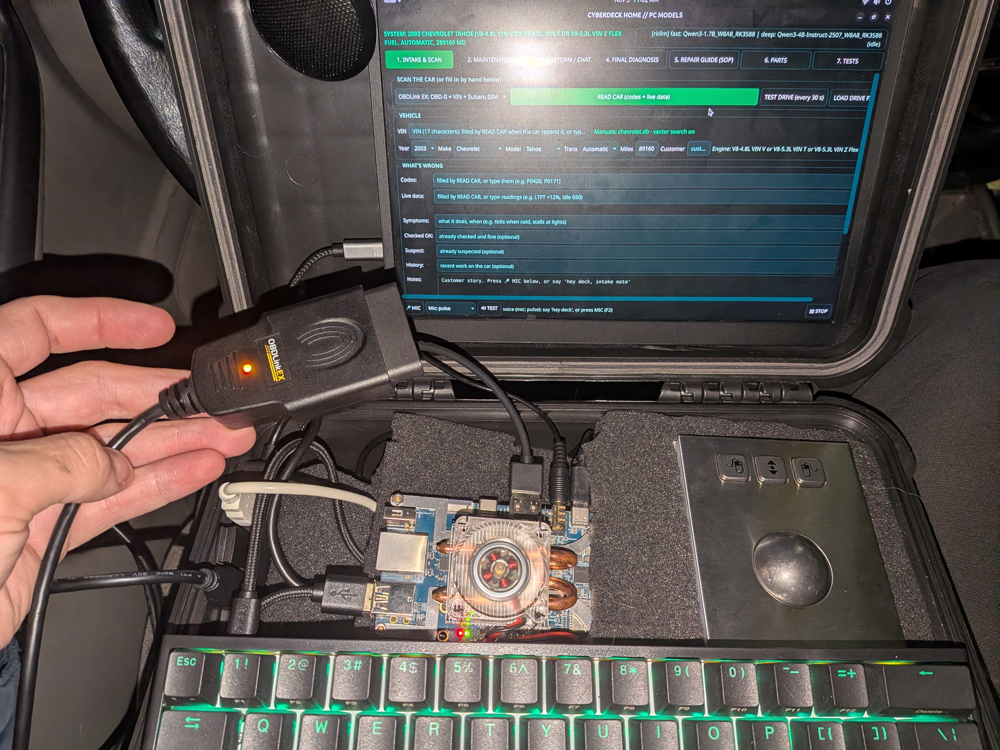
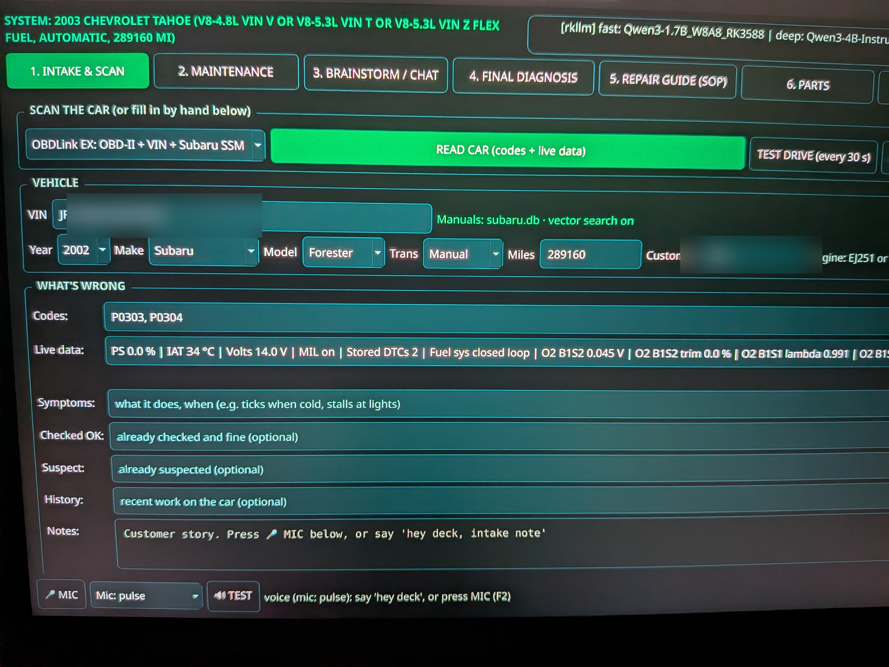
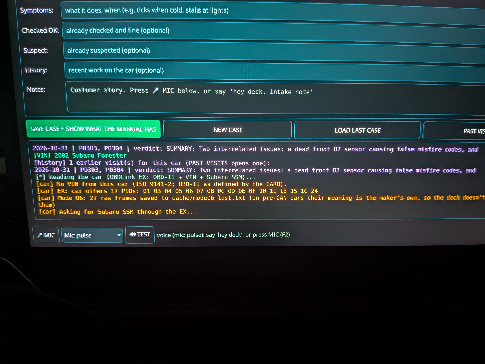
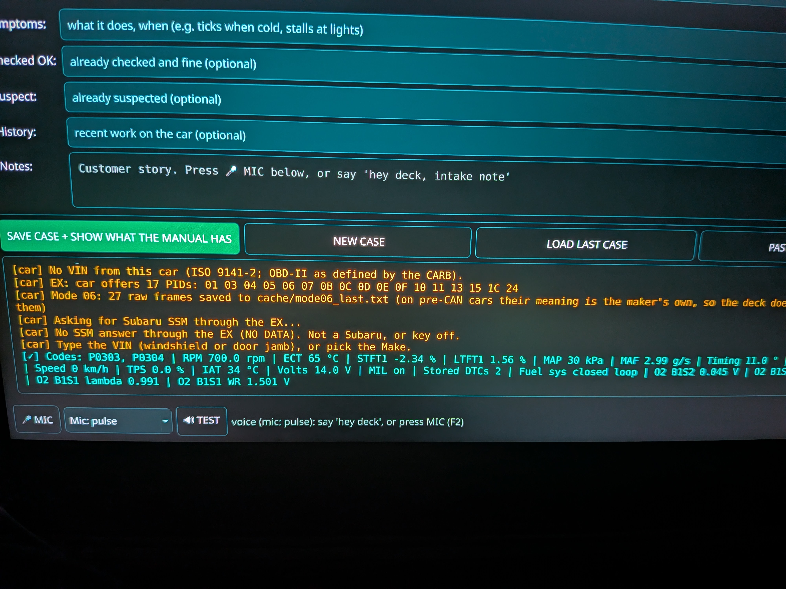
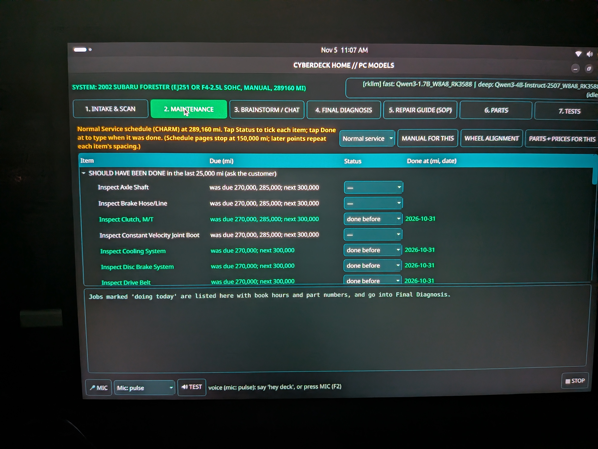
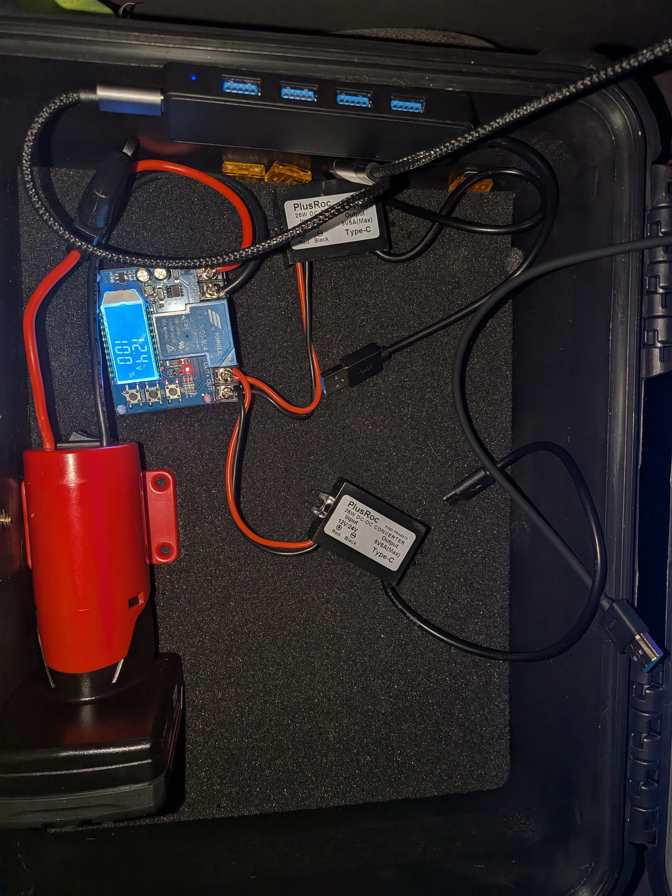
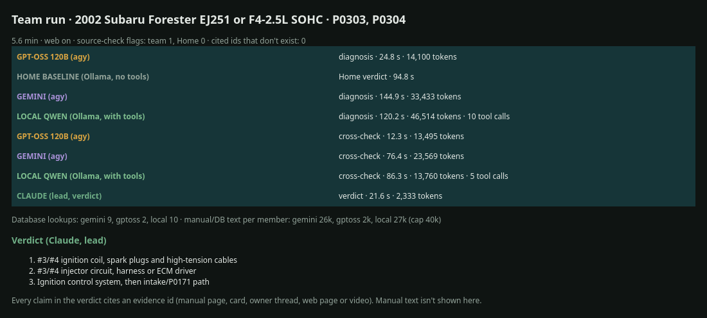
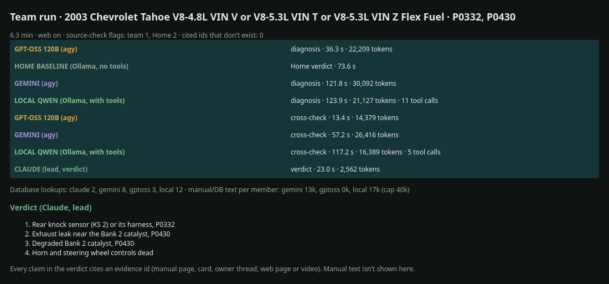

# Open Diagnostic Cyberdeck

A self-contained car diagnostic deck built on an Orange Pi 5. Plug it into a car and it works out what the car
is, reads codes and live data, walks you through the factory diagnostic chart one step at a time, suggests
likely causes, quotes parts and labor, and **cites its source for every step, spec and price**. Everything runs
offline on the deck: local Qwen3 models on the RK3588 NPU, and service-manual knowledge bases stored as
SQLite. When a bigger PC is reachable (over Tailscale, say from a phone hotspot), the deck can hand the
thinking to much larger models running there.

It started on a 2002 Subaru Forester and a 2003 Chevy Tahoe, but nothing is hard-coded for either. There is one
knowledge database per make (`kb/subaru.db`, `kb/chevrolet.db`, ...), and builders exist for 50+ makes.

> **This repository is code only.** It contains no service manuals, no CHARM content, no built databases, no
> scraped forum text and no model weights. The builders in `kb/` make the databases from sources you have the
> right to use. Want to build one yourself? **[docs/BUILD_GUIDE.md](docs/BUILD_GUIDE.md)** walks through it
> from parts list to first scan.

## Design principles

These ideas have been the core of the project since the first version, and every part of the deck follows from them:

- **Keep the model's job small.** Code does everything that has an exact answer: what each live reading means,
  the arithmetic, which diagnostic step applies to the codes you scanned, counting confirmed fixes, and the real
  spec from the manual. The model does the one thing it's good at, which is reading the evidence it's handed and
  explaining it. That's why a 1.7B or 4B model on a small board is enough.
- **Every answer has to be checkable.** The factory manual comes first and wins, every step, spec and price cites
  its source, owner fixes count only when confirmed, and anything else is labelled as an idea or a claim.
- **Empty beats wrong.** A missing spec costs you a lookup. A wrong torque spec costs you a stripped bolt. When no
  source has the answer, the deck says so.
- **Do the heavy work ahead of time.** The big PC spends GPU hours building databases, search vectors and DTC cards
  so the deck in the field only has to look things up. Everything the deck carries is compressed (8-bit models,
  8-bit vectors, WebP pictures), and the slow 4800-baud car link is worked around, not fought.
- **Offline first.** Everything works on the deck with no connection. A bigger PC is a bonus when it's reachable.
- **You can always skip the AI.** The manual search, spec lookups and the chart walker work with no model at all.

## Why it's more than a code reader

A basic OBD-II scanner tells you a code and maybe a definition. This deck gives the models **the car's live engine
data and all of the databases at the same time**: the factory diagnostic tree, specs, owner-confirmed fixes, TSBs and
complaints, plus what you saw, heard and smelled at intake. That combination is where the deep, useful diagnosis comes
from, especially for faults that are hidden or a bit obscure.

For example, it can read the fuel trims at idle, at cruise and under load and compare them with the O2 sensor
readings, timing advance, MAF/MAP and coolant temperature. That separates a vacuum leak (trims high at idle, normal
under load) from a weak fuel pump or a dirty MAF (the opposite), or catches a sensor that's reading plausibly but wrong.
All of that sits alongside the codes and the manual's own test steps. Python works out what each reading means before
the model sees it, and every conclusion still has to cite its source.

The Chat screen is also useful as a sounding board, like talking the problem over with a mechanic. Throw out your own
theory ("could it be the coil pack?") and it checks the idea against the live data, the factory manual and the
community fixes from Reddit and the forums. It tells you what fits, what doesn't and the quickest test to settle it,
instead of just agreeing with you.

In the author's use this goes well past what a simple OBD-II scanner shows. It's still a diagnostic aid, though:
confirm with the manual's tests before you replace parts.

## Why it's a RAG system

This is a retrieval-augmented generation (RAG) project: the models don't diagnose from what they learned in training.
For every question the deck first searches the make's knowledge base (keyword search plus embeddings), pulls the
matching manual pages, diagnostic trees, spec rows and cards, and hands those to the model with the car's live
data. The model's job is to reason over that evidence and explain it, not to remember facts.

How a question flows from the car and the databases to the model's answer:



More diagrams (how the databases are built, what's inside each one, and what each Brainstorm mode does and saves, how Final Diagnosis builds its plan, and how cards are baked)
are in [docs/ARCHITECTURE.md](docs/ARCHITECTURE.md), with pictures in [docs/images](docs/images).

It has to be built this way for two reasons:

- **Hallucinations.** A language model asked from memory for a torque spec, a wiring color or the next step of a
  diagnostic chart will often give a confident, plausible and wrong answer. On a car that can mean a stripped bolt or
  a replaced part that was never bad. With retrieval, every fact comes from a real page, and the answer cites it.
  (There's a meme video of a guy standing in the empty engine bay of his car, right where the engine used to be,
  scratching his head while a chatbot tells him: *"Yes, I was wrong. You actually don't need to remove the engine to
  get the battery out! Let's put the engine back in, and I'll show you how to remove the battery!"* This project is
  built so that never happens to you.)
- **Small models on small hardware.** The deck runs 1.7B and 4B models on the Orange Pi's NPU. Models that size can
  reason well over text you give them, but they can't hold the service manuals for decades of cars in their weights.
  Even the 35B and 80B home-PC models don't know spec-level detail reliably. Keeping the knowledge in SQLite
  databases means a small, fast model is enough, and adding a car or a make means loading data, not retraining.

**How well the search works, measured.** On a fixed set of 34 real diagnostic questions, the hybrid keyword +
embedding search puts the right page in the top 3 for 31 of them (up from 25 with the original keyword search), and its mean
reciprocal rank went from 0.63 to 0.85. Across 47 makes, typing a trouble code finds that code's own diagnostic
procedure in the top 3 every time (380 of 380), and spec questions find the right spec about 93% of the time
(`kb/eval_make.py`). That measures the search, not the final diagnosis, but every answer starts from it.

## Built to stay grounded, not to guess

The usual fear with AI is that it confidently makes things up. This project was designed from top to bottom around
that problem:

- **The models answer from the databases, not from memory.** Every question first goes through retrieval over the
  make's knowledge base (manual pages, diagnostic trees, spec tables, cards), and the prompts require the answer to
  come from what was retrieved.
- **The manual comes first and wins.** The factory diagnostic tree is checked first, then the baked card, then other
  manual pages. Community fixes are used only when owners confirmed them, and forum ideas are labelled "ideas only".
- **Every step, spec and price cites its source**, so you can open the page and check it yourself.
- **Python does the exact work.** Diagnostic-tree questions about the codes you scanned, and the meaning of each
  live reading, are worked out in code before the model sees them, so the model doesn't do the arithmetic. Every
  reading reaches the model already labelled in range, low or high by Python. Testing showed why that matters:
  given only the raw number, a model read a perfectly normal 12 °C coolant temperature on a cold engine as
  overheating. With the label, it doesn't.
- **Embeddings find the right page** even when your wording doesn't match the manual's. That means the model isn't
  left to fill gaps on its own.
- **Known-bad data is kept out.** Some early helper scripts and data tables were drafted with an AI assistant, and
  checking them against the cite-everything rule showed how much of it was invented: "hand-verified" torque rows
  with no source, an ECU command table with bad checksums and made-up addresses, and wrong live-data addresses.
  One alarming "-22% long-term fuel trim" turned out to be the atmospheric pressure reading. None of it could point
  to a source, so all of it was thrown out. That's the rule doing its job. The deck refuses any ECU write except
  the documented, reversible tests.
- **Empty beats wrong.** When no source gives a spec, a range or a part number, the deck says so instead of filling
  the gap. A spec search never falls back to a loose match, because the wrong part's torque value is worse than none.
- **Chat rebuilds its prompt from scratch every turn**: the case, fresh manual text for the codes, symptoms and the
  question, and only the last few exchanges. Nothing depends on the model's own memory, so a long chat never fills
  up and resets, and a vague follow-up like "explain deeper" can't drag in unrelated manual pages.
- **You can always skip the AI and read the manual yourself.** Typing `/fsm <words>`, `/torque <part>` or
  `/fluids <system>` in Chat returns the manual's own text and spec rows straight from the database, with no model
  involved. `shopdeck` walks the factory diagnostic charts with no LLM at all.

No language model is perfect. But here an answer has to point at a real source, so an unsupported claim is easy to spot
and doesn't quietly turn into a repair step.

---

## What it does

### 1. Identify the car
- Reads the VIN over OBD-II (mode 09), or takes a typed one.
- If there's no VIN (common before 2005), it identifies Subarus from their SSM2 ECU ID through a RomRaider-derived
  ECU table (`kb/romid.db`), and remembers the VIN you type for that ECU next time.
- Decodes the VIN offline with NHTSA's vPIC database (optional local PostgreSQL copy), with a cached online
  fallback. Then it loads that make's knowledge DB, scoped to the right model, year and engine.
- See `app/vehicle_id.py` and `app/VIN_DECODING.md`.

### 2. Read the car
| Cable | What it gets |
|---|---|
| **OBDLink EX** | Generic OBD-II on any 1996+ car: stored and pending codes, **every mode 01 PID the car says it supports** (O2 sensors included), mode 06 test results, VIN. It also talks Subaru SSM2 through the same cable, and GM mode 22 extended PIDs (`chevrolet/gm_live.py`). |
| **Plain KKL cable** | Subaru SSM2 on the K-line (4800 baud): the ECU's own DTC table, the switches, and every live value the ECU advertises in its init-reply capability bits. |

- **TEST DRIVE** repeats the read every 30 s and writes each sample to a crash-safe JSONL drive file.
- Live readings are put into plain words in Python before any model sees them (`app/live_data.py`,
  `app/telemetry_ref.py`), for example "engine still cold" or "trims adding fuel". They're also judged against the
  manual's own specified ranges where the manual has them, and each range quotes the row it came from.
- **Same reading, whichever cable.** The two cables report values in different forms and units. The telemetry
  layer converts both into the same named readings, so the ranges, comparisons and history work the same either way.
  Which cable to use is picked from the car's detected protocol, not from a list of makes.
- Closed manufacturer tools (FORScan and others) get an **OPEN <tool>** launcher button that hands over the
  cable. The deck never extracts or copies their internals.

### 3. Diagnose
Two apps share the same databases and can be used independently:

**Home app** (`app/cyberdeck_gui.py`, PyQt6, keyboard-first, landscape or portrait)

| Screen | What it does |
|---|---|
| Intake & Scan | Car, codes, symptoms and notes (typed or dictated), READ CAR, TEST DRIVE, LOAD DRIVE FILE |
| Maintenance | A checklist of the routine maintenance the factory schedule calls for over the past 25,000 miles at this car's mileage, read straight from the manual's service-interval pages (no model involved). Tick off what's been done and what you're doing today; the ticks are remembered on the car's next visit |
| Chat | A brief, conversational back-and-forth that already knows the case and is grounded in the factory manual. If you propose a cause, it weighs it on the evidence (what fits, what doesn't, the quickest test) instead of just agreeing. Slash commands: `/torque`, `/fluids`, `/fsm`, `/part`, `/common`, `/chart`, `/debate`, `/wildcard`, `/save` and more |
| Final Diagnosis | Most likely cause, what rules out the rest, and the next test. Multi-tab, with owner-reported ideas listed last and labelled "ideas only". **THINK HARDER** reruns it on a reasoning model that also reviews the first plan |
| Repair Guide | Numbered procedure assembled from manual excerpts, with the manual's pictures shown beside the steps so you can look at the diagram while you read: figures from the factory PDFs are stored on the deck, and CHARM pictures are streamed from the PC's picture server when it's reachable. Specs are always looked up, never generated |
| Parts | OEM part numbers from the make DB, which other models share the part, QR codes for parts-store and junkyard searches, and a junkyard quote (yard price list plus book labor hours) |
| Tests | Two-way tests, locked down (see Safety) |

**Every car gets its own history.** Each car gets its own working SQLite file in `records/`, named by its VIN (or
by the customer name plus year/make/model when no VIN can be read). It keeps every READ CAR and test-drive reading
with its time, each value checked against the manual's normal range for that make (in, low or high, worked out in
Python), every visit with its verdict and maintenance ticks, and the whole chat. Scan the same car again and its
history comes up on the deck: PAST VISITS opens any earlier visit, and the case the models see gets a line comparing
today's values with the same values at earlier visits. Open the file in any SQLite tool (DB Browser for SQLite)
to look back over a car. The files stay on the device that runs the app (`car_records: false` in config turns them
off). It's handy for your own car, friends and family, or repeat customers.

**Common issues.** The COMMON ISSUES button in Chat (`/common`) shows what this model and year is known for, and at
what mileage. It's useful when you start a diagnosis, because knowing what's very common for that car tells you
what to look at early. It's just as handy when you're inspecting a used car before you buy it, so you know exactly
what to give a good once-over. The counts are worked out in Python from the make's database before any
model writes a word: NHTSA owner complaints grouped by system and by the mileage the owner reported, recalls, TSBs
and confirmed forum fixes. The model only puts those numbers into words and never adds a problem of its own
(`app/common_issues.py`).

**A searchable shop manual.** You don't need a diagnosis to use it. Type any part or job into the Repair Guide
tab (or `/fsm` in Chat) and the deck pulls up that car's own factory procedure from CHARM and the service manuals,
with the steps, specs and pictures. It works like a Haynes or Chilton manual you can search, for every make in the
database.

**diagent** (`python -m diagent gui`), the strict one. It walks the manual's own diagnostic chart step by step. Python
answers any step it can from the scan, checks every number you type against the cited spec, and watches live data
for "until X reaches N" steps. The model can only cite sources it was handed; uncited values and invented steps are
rejected by the harness. Every case ends with an HTML work order. There's a scripted test harness that generates
scenarios across makes and code families (`python -m diagent gen`, `python -m diagent test`).

**From diagnosis straight to parts.** Once there's a verdict or repair, the Parts screen pulls the part names out of
the repair line by itself and looks up the OEM part numbers for that exact car in the make's database. It shows which
other models share each part, then puts up a **QR code per part for each store**: O'Reilly, AutoZone, RockAuto and
Row52 junkyard inventory near your ZIP. Scan one with your phone and you're on that part's search page, ready to
check price and stock. There's also a junkyard quote (yard price list plus book labor hours) and a printable parts sheet
with all the codes. `/part <name or number>` does the same from Chat.

**shopdeck** (`python -m shopdeck`) is a no-LLM chart walker with a terminal UI for use over ssh. It's experimental.

### 4. Where answers come from, in priority order
1. **The factory diagnostic tree** for the code (DTC procedure), with steps that ask "which codes are set?"
   answered from the scan. The trees are parsed, not pasted: a manual procedure is a big step table (median about
   3,400 characters, up to 18,000), and cutting one to fit a prompt can drop the very steps that matter.
   `app/procedures.py` splits them into whole numbered steps, follows the manual's own "refer to" links
   to other procedures, and fits the steps that matter for this scan into the budget.
2. **Baked DTC cards** (`card_baking/`): one card per trouble code, combining the manual's procedure with real-world
   fixes **scraped from Reddit and owner forums and checked for credibility** before they count:
   - Threads are filtered to likely repair threads. A model then pulls out the car, the code, what fixed it, and
     whether the fix was confirmed: the original poster says it worked, or another owner with the same problem does.
     Suggestions nobody confirmed and unresolved threads don't count as fixes.
   - Every extract must quote the sentence it came from, and a quote that isn't actually in the thread throws the extract out.
   - Causes are ranked by how many owners confirmed them. The card is written with a source id on every claim, then a
     second pass drops any claim its sources don't support (dropped claims are kept for review).
   - Torque values, capacities and part numbers on a card are copied from the manual tables, never written by a model.

   **What card baking is, in plain words:** each card belongs to one diagnostic trouble code (the codes behind a
   check engine light, like P0301) on one car model and year range. When the deck reads that code from the car,
   it pulls that car's card for it. With no code set, no card is used. A manual tells you how to test for a code,
   but not which cause owners actually find most often. A card adds that. On the PC, a small model reads thousands of forum and Reddit threads
   and keeps only fixes the owner confirmed, each backed by a quote that's checked against the thread. Python
   counts those fixes per cause. A bigger model then writes one card per code from the manual's procedure, the
   counts and the TSBs, citing a source for every claim. A second pass throws out any claim its source doesn't
   back up, and Python strips any spec or part number the model wrote and puts in the manual's real ones. It runs
   once per car model (about 6 hours on an RTX 3070), so the deck just looks the card up.

   **Why bake them ahead of time:** the deck's small models have a short context window and little time in the
   field. Reading dozens of raw threads per code would use up that room and invite the model to get lost or invent
   things. A card packs the useful part into a few hundred tokens: what owners actually saw, heard and smelled with
   that code, which causes turned out to be real and how often, and the diagnostic logic for telling them apart
   (what to check first and what each result means). The small model gets real-world context and a reasoning path
   it couldn't build itself, without spending its budget on raw forum text. It also gives the models some room to
   look past the service manual without slipping into made-up answers: every cause on a card is one that real owners
   confirmed, with its source.

   **Where the idea came from:** a question about how the original Pokémon games fit a whole world onto a Game
   Boy, and whether that kind of squeezing could work on the Orange Pi. Writing assembly wouldn't help here: the
   NPU library and SQLite are already native code, and the car's own link is capped at 4800 baud. But the mindset
   carries over: do the heavy work ahead of time on the big machine, compress everything (8-bit models, 8-bit
   search vectors that are 4x smaller), and keep what the small device has to read short. Card baking is that idea
   applied: the RTX 3070 spends hours so the deck can answer in a moment.

   

   **Why community data belongs next to the manual at all:** factory service manuals are written around the factory's
   own procedures, warranty repairs and liability, for a car that's been maintained by the book. Most cars aren't,
   especially older ones and ones with several previous owners. Skipped services, past repairs and worn parts
   cause problems the manual never describes. Owners and mechanics have also found shortcuts and workarounds the
   manual doesn't mention, like pulling an engine without disconnecting the power steering or the A/C system. The
   community layer brings that real-world experience in, and the manual stays first for specs and test steps.

3. Other manual pages: specs, connector views, component tests, cross-references.
4. **Community reports**: what owners tested, ruled out and fixed, extracted from forum and Reddit threads and
   linked back to manual sections (`kb/build_community.py`). They're shown as supporting evidence, never as the
   answer, and every outcome is labelled **"claimed"**: an owner said it fixed the car, nobody verified it.

   **How the threads are read.** Every thread kept by the keyword pass is searchable as raw text. The useful ones
   then get a full read by a local model that pulls out, as structured JSON, the car, the symptoms, each test and
   its result, what was ruled out and why, the suggestions, and the outcome. Every item has to quote the sentence
   it came from, and Python checks the quote is really in the thread.
   - **Which threads:** ones that mention a test, an outcome or a trouble code *and* have at least 3 replies, which
     is 68,770 threads for Subaru and Chevrolet. Threads where the owner reports a fix go first, so the most useful
     ones are done early.
   - **Which model, and why:** a 9B model (Qwen3.5-9B, 4-bit, four parallel requests on the RTX 3070) was tested
     against the 30B model it replaced, on the same threads, with the results graded blind. The 9B made fewer
     mistakes (9 wrong items vs 26), failed the quote check less often (1.1% vs 3.7%), and ran about 4.5x faster
     (691 vs 148 threads an hour). It did return slightly more malformed replies (2.9% vs 0.6%). A lighter "code
     fills the easy fields" mode was faster still but was dropped, because it missed important items. Accuracy decided; speed only counted once accuracy held.
   - **Sharing one GPU:** the run takes about 100 GPU hours, so it works in scheduled windows (7 pm-10 am and
     11 am-4 pm). In between, the extraction stops cleanly, the GPU is handed back, and the picture server and the
     Home models are free for real diagnosis. It resumes where it left off, without losing or repeating threads.
5. NHTSA complaints, TSBs, recalls and investigations; StackExchange Q&A; a general automotive knowledge base.

Manual sources: Subaru factory service manuals (PDF), Operation CHARM (most makes, up to the early 2010s) and, optionally,
LEMON Manuals for newer cars. See [the build guide](docs/BUILD_GUIDE.md#where-the-manuals-come-from).

Rules the code follows: no hard-coded symptom-to-cause maps, no canned answers. When there's no source, it shows
nothing rather than guessing. Broken chart steps are shown as the page text with a jump to the page, never filled in.

### 5. Models
| Where | Fast | Deep | Think harder | Search |
|---|---|---|---|---|
| Deck (RKLLM on NPU) | Qwen3-1.7B | Qwen3-4B-Instruct-2507 | Qwen3-4B-Thinking-2507 | Qwen3-Embedding-0.6B |
| Home PC (Ollama, `--home`) | Qwen3.6 35B-A3B | Qwen3-Next 80B-A3B Instruct | Qwen3-Next 80B-A3B Thinking | same |

Home mode falls back to the deck's own models whenever the PC can't be reached. (Speeds quoted anywhere in these docs were measured on an RTX 3070 PC and a 16 GB Orange Pi 5; yours will vary with your hardware.) There's no agent framework:
each model has a fixed job, and Python does the bookkeeping.

### 6. Voice (offline)
"Hey deck" wake word (Vosk, closed phrase list, so shop noise is ignored), dictation into any text box
(whisper.cpp), and spoken answers to quick lookups like "torque for exhaust manifold" (pyttsx3 / espeak-ng /
Piper). Diagnoses and prices stay on screen. See `app/README.md`.

---

## Why an Orange Pi 5

The deck has to run two language models, an embedding model, offline voice, a PyQt app and the car link, all at
once, offline, on a tool battery. The Orange Pi 5 fits that job better than the usual small boards:

- **It has an NPU that runs LLMs.** The RK3588 chip has a 6 TOPS neural processing unit, and Rockchip's RKLLM
  toolkit converts a normal Hugging Face model (Qwen3 here) into a quantized 8-bit `.rkllm` file that runs on it. That
  is a one-time conversion on the PC, not training. The models run on the NPU, which leaves the CPU free for the
  app, search, voice and the car link.
- **16 GB of RAM.** A 1.7B and a 4B model loaded side by side, plus the embedding model and SQLite, need room. 16 GB
  holds them all without swapping.
- **Eight CPU cores** (four fast Cortex-A76, four efficient A55). The voice listener runs on the small cores so
  it never slows the big ones.
- **An M.2 NVMe slot**, so the make databases and manual pictures live on a fast SSD instead of an SD card.
- **Low power.** It runs from a 12 V tool battery through a buck converter.

**Compared with a Raspberry Pi 5:** a great general-purpose board, but it has no NPU of its own, so a language
model runs on the CPU and competes with everything else the deck is doing, unless you add a separate
accelerator board.

**A Raspberry Pi can still work in Home mode.** If the models are always streamed from a desktop running Ollama
(over Tailscale, see Home mode), the board only runs the app, search and the car link, and a Raspberry Pi 5 should
manage that. The cost is offline use: with no NPU there's no model on the deck when the PC can't be reached, so
out in the field you'd be down to the no-model tools (manual search, specs, the diagnostic trees, live data). The
Orange Pi's NPU is what lets the deck keep diagnosing with no connection at all. (This setup hasn't been tested on
a Raspberry Pi yet.)

That also makes it the cheapest way in, and a use for a Raspberry Pi you already have lying around, as long as
you have a desktop with a decent GPU to run the models. Rough minimums (untested, from what the app needs):
- **Raspberry Pi 5 or Pi 4 with 4 GB or more, on 64-bit Raspberry Pi OS:** should run the full app. With 4 GB,
  turn the embedding search off (`"embed_model": "off"`) and use keyword search only;
  with 8 GB the embedding model can run on the Pi's CPU.
- **Pi 3 (1 GB):** marginal. The window and keyword search might run, but slowly, with no room for embeddings.
- **Pi Zero 2 W (512 MB):** not enough memory for the app. It could only ever be a small OBD-to-Wi-Fi bridge, and
  that isn't built.

**Compared with an NVIDIA Jetson Nano:** the original Nano has only 4 GB of memory, shared between the CPU and the
GPU, which isn't enough for a 4B model plus everything else, and its software is stuck on an old Ubuntu. The newer
Jetson Orin Nano is capable, but it costs more and has 8 GB of shared memory, half of what the Orange Pi has.

**The trade-off:** RKLLM is Rockchip's own toolkit, so models need that conversion step, and the board's Linux
images are community-maintained. You need a kernel with NPU driver 0.9.7 or newer for RKLLM 1.3.1 (the build guide
covers this). For this job, that's a fair price for a real NPU and 16 GB.

## Engineering notes

- **One database per make.** The deck only has to hold the makes it will actually see, and each make can be
  rebuilt on its own without touching the others. Adding a make is one command (`tools/make_full.sh <make>`), not a
  project. The builds are resumable, and a lock makes sure only one GPU job runs at a time.
- **Models and databases are modular.** No model is trained or fine-tuned for this project: all the car knowledge
  lives in the databases, and the models only read it. So you can swap any model for a bigger, smaller or newer one
  to suit your hardware, and drop in better ones as they come out. On the PC that means changing a model name in
  `app/config.json` (`home_fast`, `home_deep`, `home_think`, any Ollama model). On the deck it means converting the
  new model to RKLLM format (`tools/export_qwen3_rkllm.py`, a one-time conversion, not training) and pointing
  `fast_model` / `deep_model` / `think_model` at it. Databases work the same way: copy in only the makes you need,
  or rebuild one when new data arrives, and the app picks it up. The one exception is the embedding model, which
  is tied to the stored search vectors: change it and you re-run the builder's `embed` step.
- **No per-ECU tables for Subaru live data.** The ECU's own SSM2 init reply carries capability bits that say which
  live values, switches and tests it supports, so the deck reads them straight from the car instead of needing a
  definition file for every ROM. As a cross-check, the trouble-code maps from FreeSSM and RomRaider (the two
  open-source Subaru tools) were compared and agree on 537 of 539 codes.
- **By the numbers** (as built on the author's PC). The raw material is huge:
  - **Manuals:** CHARM service information for 53 makes (decades of cars), about 650 GB of manual pictures, plus
    ten converted factory service manuals for Subarus.
  - **Community:** over a million Reddit and forum threads across 37 makes, with millions of comments (Subaru alone
    is about 88,000 Reddit posts and 767,000 comments). A cheap keyword pass kept 803,000 useful threads, a local
    model read the repair threads for confirmed fixes, and 80,036 Subaru threads are embedded for search.
  - **Government data:** NHTSA TSBs, complaints, recalls and defect investigations for every make (a 2 GB source
    database), plus the NHTSA VIN decoder.
  - **Cards:** 176 baked for the 1998-2002 Forester and 1,686 for the 2003 Tahoe.

  All of that is boiled down into one plain SQLite file per make that a 16 GB Orange Pi can search offline in a
  moment. The Subaru database, for example, is about 750 MB and holds roughly 160,000 manual sections, 6,500 torque
  specs, 46,000 labor and part-number rows, about 18,000 TSBs and 13,500 complaints, with keyword indexes and 8-bit
  search vectors built in. Pictures stay on the PC and are streamed when it's reachable, or shipped as small WebP
  files for the manuals that matter.
- **Playing fair with data sources.** The Row52 junkyard crawler is switched off because Row52's terms forbid
  scrapers, so yard inventory comes from lists you paste or alert emails. Forums whose robots.txt blocks AI
  crawlers, or that sit behind Cloudflare, are skipped, never bypassed. Closed tools' internals are never extracted.
- **Built for the field.** The finished deck has no touchscreen: everything works from the keyboard, and the
  trackball is a bonus. It runs from a Milwaukee M12 tool battery through a low-voltage cutoff and two buck
  converters, and the screen layout works in landscape or portrait. The dark theme's colours always mean the same
  thing: forest green is your turn, teal is only ever live data, purple is a source or citation, and amber is out
  of spec, always with a word next to it, never colour alone.

## Safety

- **Reading is the default.** READ CAR only sends identify and read requests.
- The only writes are on the **TESTS** screen, behind a TEST MODE switch that starts off on every launch:
  - FreeSSM's Subaru actuator tests. Only the ones this ECU advertises are offered, the test connector must be in,
    the engine must be off, each test asks for confirmation, and each one stops after 30 s.
  - Clear Subaru ECU memory, and OBD-II mode 04 clear codes.
  - STOP ALL, which never asks.
  Anything else is refused in code (`app/ssm/ssm_tests.py`).
- **Never:** flashing, security-access unlocks (UDS $27, GM $AE), adjustments, or commands that aren't documented
  by an open-source project you can check. Please keep it that way in forks.
- This is a hobby project with no warranty (see LICENSE). Check every reading and spec against the factory manual
  before you put a wrench on a car.

---

## Repository map

| Path | What |
|---|---|
| `app/` | Home app, LLM backends (RKLLM ctypes + Ollama), retrieval, live data, voice, theme |
| `app/ssm/` | Subaru SSM2: telemetry logger, capability decoding, tests, cable detection, SSM-through-EX probe |
| `diagent/` | Chart-walking diagnosis app with harness, tools, policy checks and scenario generator |
| `teamdeck/`, `team/` | Team mode: the Home app with a team (Claude, Gemini, GPT-OSS, local Qwen) as its model; PC service, read-only MCP server, runner ([docs](docs/TEAM_MODE.md)) |
| `shopdeck/` | No-LLM chart walker (GUI + TUI) |
| `kb/` | Knowledge-base builders, retriever, embedder, telemetry and community builders, tests |
| `card_baking/` | Per-DTC card baker (PC GPU): forum/Reddit fix extraction with confirmation and quote checks, then sourced cards |
| `chevrolet/` | The generic per-make pipeline, make profiles, and GM VPW / mode 22 live reader |
| `parts_sourcing/` | Part-number interchange, QR links, junkyard sync and quotes |
| `tools/` | Full per-make builds, deck sync, CHARM picture server, RKLLM model export, status |
| `cyberdeck_forge/charm_ingest.py` | Reader for a CHARM LMDB archive |
| `build_subaru_diag_db.py` | NHTSA flat files + RomRaider definitions -> sourced DTC/TSB DB |
| `docs/BUILD_GUIDE.md` | Step-by-step build: hardware, OS, models, databases, first scan |
| `docs/DESIGN_HISTORY.md` | How the design evolved: origin, timeline, every idea's versions, dead ends, key decisions |

## Quick start (if you already have the hardware and databases)

```bash
git clone https://github.com/charlie-nolan/open-diag-cyberdeck.git
cd open-diag-cyberdeck && python3 -m venv venv && venv/bin/pip install -r requirements.txt
cp app/config.example.json app/config.json
cd app && ../venv/bin/python cyberdeck_gui.py            # add --home to use the PC's models
```

The checkout can live anywhere: every script and module finds its files relative to its own place in it.
For everything else, see the [build guide](docs/BUILD_GUIDE.md).

## Status

Working: car ID, OBD-II reads through the EX on real cars (a 2003 Tahoe on J1850 VPW), SSM2 live data over KKL on a
2002 Forester, the two-way (actuator) tests on that Forester in test mode, both apps on the PC and the deck, Home mode,
and builders for 50+ makes.
Not yet proven on a car: SSM2 through the EX, and the 4B models on the NPU under load.

Photos (placeholders until proper screenshots and screen recordings):

| | |
|---|---|
|  |  |
|  |  |
|  |  |
**Team mode** (Nov 2026): a separate app, teamdeck, with the same screens, where Claude, Gemini, GPT-OSS and the local
Qwen work each case together with read-only database lookups, and Claude makes the final call. In PC tests it had
half the unsupported numbers of the local models alone. Details: [docs/TEAM_MODE.md](docs/TEAM_MODE.md).
The Subaru database is the furthest along (factory manuals, baked cards, owner threads); Chevrolet has cards and owner
threads; the other makes tested have CHARM and NHTSA data only, so far.

| | |
|---|---|
|  |  |

Planned: a vision pass that reads chart pictures into walkable steps, real-time parts prices, customer work orders,
and more makes' extended live data.

**A real diagnosis.** A friend's 2003 Chevy Tahoe had a dead horn and dead steering-wheel buttons. The plan was to
get the multimeter out and start checking fuses. Instead, describing the symptoms in Brainstorm was enough: the
deck pointed at a failed spiral cable (the clockspring in the steering column), a known problem on that truck that
the author didn't know about. Typing "spiral cable" into the Repair Guide tab then brought up the full replacement
procedure.
Follow-up questions in the same chat explained why the spiral cable tends to fail on that truck, and rated the job
about 7/10 if you're comfortable working around airbags, 8-9/10 if you're not, because of the airbag risk.

## Tests

```bash
venv/bin/python -m pytest                               # every suite (pytest.ini); no data files needed
venv/bin/python -m diagent test                          # needs kb/subaru.db + generated scenarios
```

The suite covers the quote checks behind the community data, the telemetry zone parser, unit handling in live
data, NHTSA layout checks, source hashes, OBD-II decoding against simulated adapters, verdict parsing and the
parts tools. Tests that need a database you haven't built skip and say why. GitHub Actions runs it on every
push (`.github/workflows/tests.yml`).

## How this was built

Built with AI coding tools (Claude Code, plus local Qwen models). I designed the architecture, set the rules (every
value cites a source, Python computes anything exact, nothing actuates without interlocks), audited the model output,
and tested everything on real vehicles. Shared in case it helps anyone working on the same cars or boards.

How the design evolved, from the first idea to now, including the dead ends and every key decision: **[docs/DESIGN_HISTORY.md](docs/DESIGN_HISTORY.md)**.

## Related project

**[aligndeck](https://github.com/charlie-nolan/aligndeck)** is a separate app by the same author: wheel alignment
(camber and toe) from printed ChArUco targets and any camera. The spin axis comes from rolling the car, so error in
how the target is mounted on the wheel drops out, and how far to turn each adjuster comes from a guided calibration
on the car. Status: validated against synthetic photos (within 0.03°, 17 tests); the first run on a real car is
still to come.

## License and credits

GPL-3.0-or-later (see `LICENSE`). `app/ssm/freessm_ssm2_tables.json` and the test commands are derived from
[FreeSSM](https://github.com/Comer352L/FreeSSM) (GPL-3), which is why the whole project is GPL.

Also used, not bundled: RomRaider logger definitions, PCMHammer's PID list (GPL-3), NHTSA vPIC / complaints /
TSBs / recalls (public domain), python-OBD, Rockchip rknn-llm, Qwen3 models (Apache-2.0), Vosk, whisper.cpp,
sqlite-vec.

Not affiliated with Subaru, GM, Rockchip, OBDLink or any parts seller. Trademarks belong to their owners.
