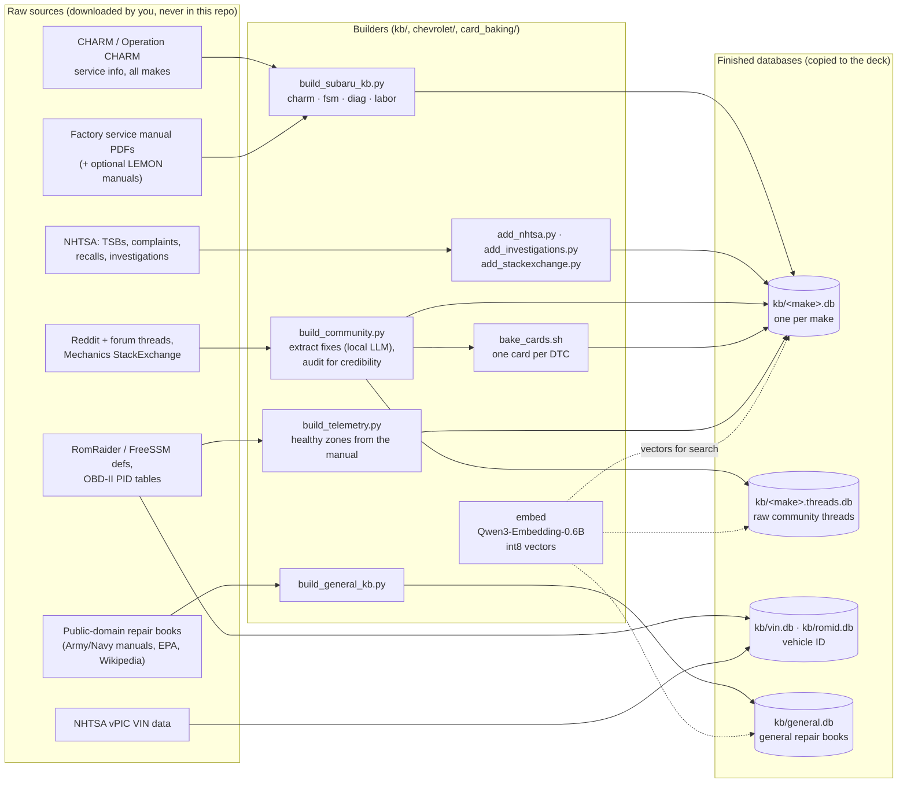
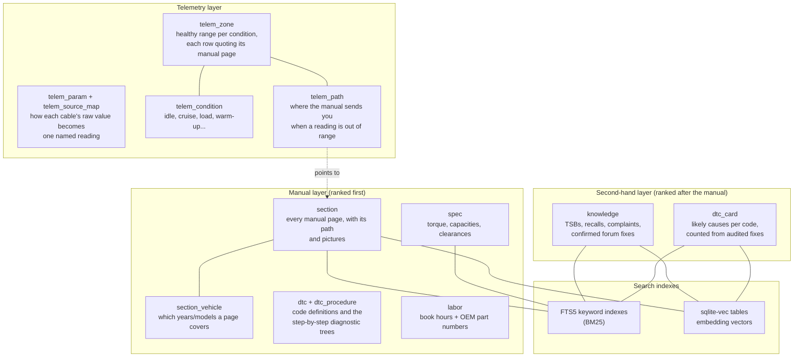
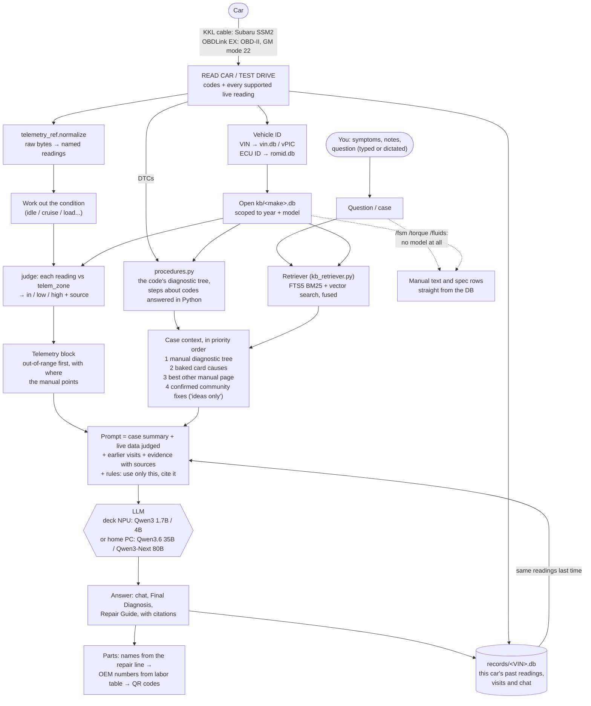

# How the databases, the models and live data fit together

Three diagrams: how the databases are built (on the PC, once), what is inside a make's database, and what
happens on the deck every time you ask a question. GitHub draws them from the Mermaid text below.

The short version: **the models never answer from memory.** Python reads the car, judges every reading against
the manual's ranges and pulls the right pages out of SQLite. The model only gets that evidence to reason over,
and it has to cite it.

## 1. Building the databases (PC, offline)

## 2. Inside one make's database (`kb/<make>.db`)

## 3. Diagnosing on the deck (every question)

### What Python does vs. what the model does

| Python (exact, never a model) | The model (reasoning over what it's handed) |
|---|---|
| Decodes the cable's raw bytes into readings | Explains what the evidence means together |
| Works out the operating condition and judges each reading against the manual's range | Weighs your theory: what fits, what doesn't, quickest test |
| Answers diagnostic-tree steps that only ask which codes are set | Orders the likely causes and the next test |
| Finds the pages (keywords + embeddings) and puts the manual first | Writes the repair steps from the retrieved procedure |
| Looks up specs, torques and part numbers | Cites the page for every step and number |
| Compares today's readings with earlier visits | |
