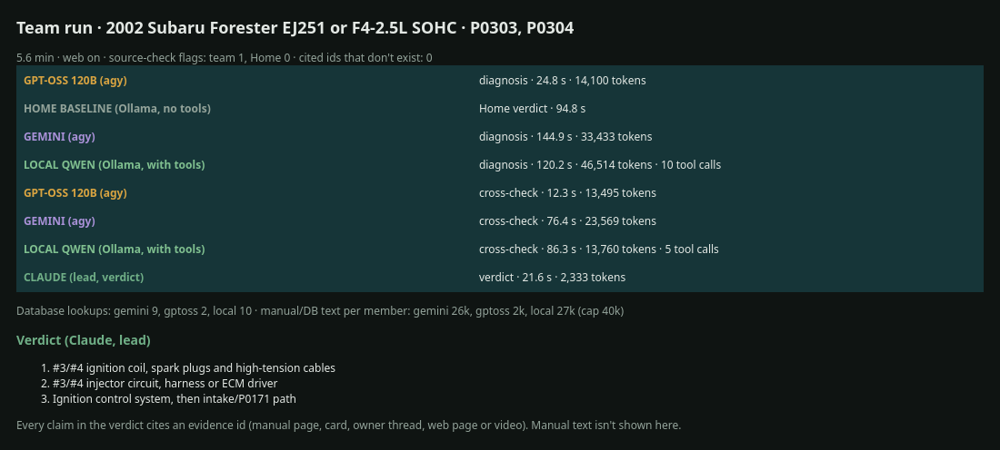
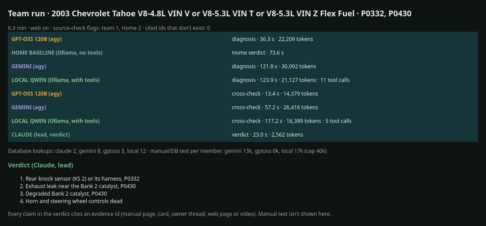
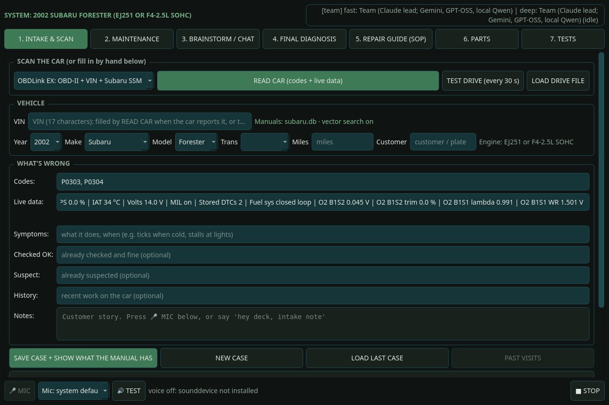

# Team mode (teamdeck)

The deck runs on local models: Qwen on the Orange Pi's NPU (RKLLM), or two larger Qwen models streaming from a PC
(Home mode). Team mode is an experiment in using the subscriptions I already pay for instead. It is a separate app,
**teamdeck**, with the Home app's screens, where every model call goes to a team running on the PC:

| Member | How it runs | Job |
|---|---|---|
| Claude (lead) | `claude -p`, read-only tools only | Weighs the team's work against the manual and writes the final answer in the app's format |
| Gemini | Google's Antigravity CLI (`agy`), sandboxed | Full diagnostician: researches, writes its own diagnosis, cross-checks the others |
| GPT-OSS 120B | `agy --model gpt-oss-120b-medium`, sandboxed | Independent diagnosis and cross-check |
| Local Qwen | Ollama on the PC, with the same tools | Another member; also the Home-mode baseline the team is measured against |

No paid API keys: Claude runs on a Claude subscription, Gemini and GPT-OSS on a Google AI Pro plan.

## How a case runs
1. The deck reads the car as usual. teamdeck sends the case to the team service on the PC (`team/service.py`,
   Tailscale only). The VIN, customer and mileage never leave the deck.
2. Each member works the case in parallel with read-only lookups into the make's databases through a small MCP
   server (`team/kb_mcp.py`): manual procedures, CHARM, specs, cards and owner reports, one page or procedure at a
   time, capped at about 40k characters per member per case. Web pages and YouTube captions must be fetched through
   the same server to be citable.
3. For a Final Diagnosis, the members cross-check each other, then Claude writes the verdict:
   SUMMARY, then per issue WHY HERE, FOR, AGAINST, TEST, REPAIR, PARTS, plus TEAM NOTES.
4. Python checks the result: every cited evidence id must exist, unsupported numbers get the amber source-check
   line, and the deck lists every lookup each member made.

## Guardrails
- Every database opens SQLite read-only; a test proves writes fail. Nothing is ever sent to the car.
- `agy` members run inside bubblewrap with an empty home folder: the repo, databases and drives aren't visible;
  only their per-run scratch folder is writable.
- Every claim needs an evidence id (manual page, card, owner thread, fetched web page, video caption line), or it is
  marked as the member's own judgement. Source rank: manual, then TSB, then owner reports and videos (ideas only),
  then the web. A web number never stands in for a manual spec.
- One run at a time, time limits per step, a few brainstorm rounds per case.

## Results so far (PC tests, Nov 11 2026)
Same cases through Home (local Qwen) and the team: the team averaged 0.8 source-check flags per verdict against
Home's 1.6, with about 24 manual citations per verdict, in 4-6 minutes per case. On real visits:

**How far along each database is.** In these tests the Subaru database is by far the furthest along: it has the factory service manuals on top of CHARM, 176 pre-baked fix cards for the 1998-2002 Forester and about 70,000 owner threads. The Chevrolet database has pre-baked cards (from the Tahoe bake) and owner threads. The other makes in the test (Dodge, Ford, Honda, Hyundai, Mazda, Nissan, Toyota) have only CHARM and NHTSA data so far: no cards and no community data, so the team worked those cases from the manual alone.





## Run it
```bash
venv/bin/python team/service.py              # on the PC (binds its Tailscale address); --install writes a user unit
venv/bin/python -m teamdeck                  # on the deck or the PC
venv/bin/python team/run.py --case case.json [--stage final|brainstorm]   # one case without the GUI
```
Needs `agy` signed in, `claude` signed in, `bwrap`, and Ollama on the PC for the local member. See
`teamdeck/README.md`.
